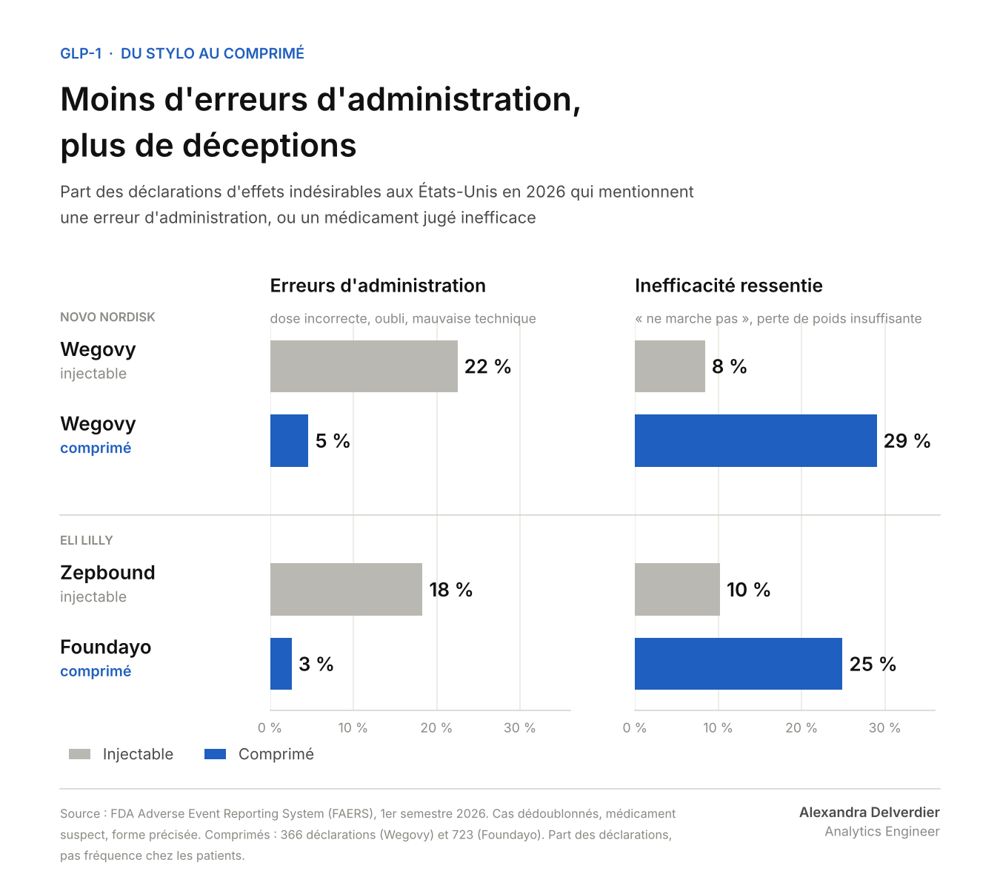
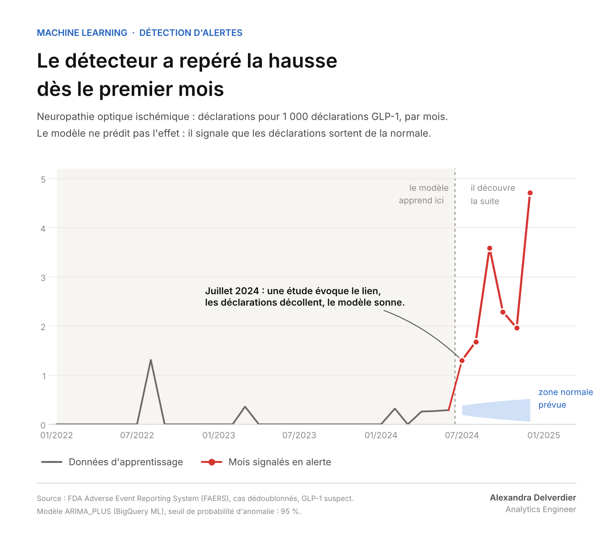
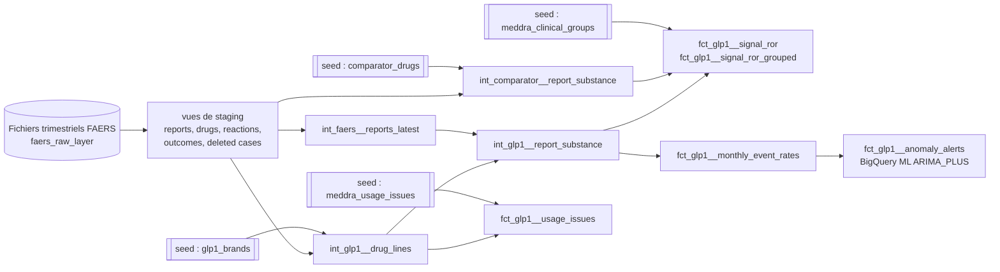

# GLP-1 et pharmacovigilance : analyse des données FAERS avec dbt, BigQuery et BigQuery ML

> **In English:** an analytics engineering project on FDA adverse event reports (FAERS) for GLP-1 drugs: a tested dbt pipeline on BigQuery, disproportionality signals (ROR), a pen vs pill comparison of administration errors and perceived inefficacy, and a BigQuery ML anomaly detector validated on two real safety alerts.

Un projet d'analytics engineering de bout en bout sur la base de pharmacovigilance de la FDA (FAERS), centré sur les agonistes du GLP-1 : Ozempic, Wegovy, Mounjaro, Zepbound, Foundayo...

Il couvre toute la chaîne : chargement des fichiers trimestriels FAERS dans BigQuery, projet dbt testé qui nettoie et modélise les données, analyse de disproportionnalité (ROR), et détecteur d'anomalies sur séries temporelles construit avec BigQuery ML, validé sur de vraies alertes de sécurité.

Réalisé par une ancienne infirmière devenue analytics engineer : la lecture clinique des données (codage MedDRA, formes galéniques, contexte des déclarations) fait partie de la méthode.

---

## Principaux résultats

### 1. Du stylo au comprimé : moins d'erreurs d'administration, plus de déceptions

Part des déclarations d'effets indésirables (1er semestre 2026) qui mentionnent une erreur d'administration ou une inefficacité ressentie, en comparant la forme injectable et la forme orale d'un même laboratoire.

| Produit | Forme | Erreurs d'administration | Inefficacité ressentie |
|---|---|---|---|
| Wegovy | injectable | 22,5 % | 8,4 % |
| Wegovy | comprimé | 4,6 % | 29,0 % |
| Zepbound | injectable | 18,3 % | 10,2 % |
| Foundayo | comprimé | 2,6 % | 24,9 % |

Les comprimés divisent les erreurs d'administration par 5 à 7, tandis que les déclarations « médicament inefficace » ou « perte de poids insuffisante » augmentent fortement. Les troubles digestifs restent présents (nausées dans 20 à 25 % des déclarations sous comprimé).



### 2. Un détecteur d'alertes validé sur de vraies alertes

Un modèle ARIMA_PLUS (BigQuery ML) apprend le taux mensuel normal de déclarations pour chaque groupe clinique, et signale les hausses inhabituelles. Pour le tester honnêtement, il a été entraîné uniquement sur les données disponibles avant chaque événement, puis confronté aux mois suivants comme à des données nouvelles.

> **Ce que fait le détecteur, et ce qu'il ne fait pas**
>
> Il **ne prédit pas** les effets indésirables. Il fonctionne comme un scope en service : il apprend le rythme habituel, puis sonne dès que les nouvelles déclarations sortent de la zone attendue.
>
> Il détecte **un changement dans les déclarations, pas un risque**. En juillet 2024, les déclarations de neuropathie optique ont augmenté parce qu'une étude venait d'associer cette pathologie au sémaglutide : le modèle a capté la réaction à cette étude, le mois même. Il ne pouvait pas la repérer plus tôt, car presque rien n'était déclaré avant.
>
> Son intérêt est **le tri à grande échelle** : surveiller chaque mois des milliers de couples médicament et effet, et orienter l'attention humaine vers les quelques cas qui méritent d'être examinés. Comprendre la cause (une étude, une revue réglementaire, des procédures judiciaires ou un vrai problème de sécurité) reste un travail humain.

| Événement réel | Date | Détection par le modèle | Type de signal |
|---|---|---|---|
| Revue de l'EMA sur les idées suicidaires | juillet 2023 | août 2023 | pic |
| Étude JAMA Ophthalmology sur la neuropathie optique | juillet 2024 | juillet 2024 | changement de palier |

En février 2026, le détecteur a signalé la gastroparésie (3 fois la borne haute attendue), le mois du lancement de la pilule Wegovy aux États-Unis. L'analyse a montré que la coïncidence de date était trompeuse : les déclarations concernaient d'anciens traitements injectables, et plus de 400 avaient été transmises par des avocats dans le cadre de procès américains. Pas de nouveau signal de sécurité, mais exactement le type d'alerte qu'un humain doit examiner avant de conclure.



### 3. Signaux de disproportionnalité (ROR, classe GLP-1 contre SGLT2 et DPP-4)

| Groupe clinique | ROR | IC à 95 % |
|---|---|---|
| Gastroparésie | 86,3 | 51,1 à 145,9 |
| Neuropathie optique ischémique | 76,3 | 24,6 à 237,0 |
| Cancer de la thyroïde | 7,4 | 4,4 à 12,4 |
| Occlusion intestinale | 4,4 | 3,7 à 5,2 |
| Atteinte de la vésicule biliaire | 4,3 | 3,7 à 5,0 |
| Pancréatite | 1,3 | 1,2 à 1,4 |
| Idées et comportements suicidaires | 1,2 | 1,0 à 1,3 |
| Inhalation pulmonaire | 0,6 | 0,5 à 0,8 |

Une analyse de sensibilité limitée aux déclarations où le GLP-1 est suspect principal confirme tous les signaux, sauf la suicidalité, qui passe de 1,2 à 3,0 selon la définition de l'exposition : un résultat instable, présenté comme tel.

---

## Les pièges de la donnée traités

L'essentiel du travail est ici. Chaque piège, s'il est ignoré, change les conclusions.

| Piège | Ce qui a été constaté | Traitement |
|---|---|---|
| Plusieurs versions par cas | 7,56 M lignes pour 6,47 M cas réels (environ 15 % de doublons) | dernière version conservée par `caseid` (`int_faers__reports_latest`) |
| Cas supprimés | 35 750 cas retirés par la FDA | exclus grâce aux fichiers trimestriels de suppression |
| Un médicament cité plusieurs fois par déclaration | une déclaration cite Mounjaro 126 fois (une ligne par stylo) | grain fixé à déclaration x substance |
| Noms de médicaments en texte libre | 479 graphies des produits GLP-1 (marque + dosage, orthographes étrangères, préparations magistrales) | seed de référence marques / substances et règles regex |
| Associations | insuline + GLP-1 (Soliqua, Xultophy) mélangées aux GLP-1 seuls | classées `insulin_combination`, exclues des analyses principales |
| Codage MedDRA | le terme « Gastroparesis » n'existe pas : environ 11 000 cas sont codés « Impaired gastric emptying » | seed de groupes cliniques avec règles d'inclusion et d'exclusion, revu terme par terme |
| Termes éclatés | « Pancreatitis » ROR 1,7 contre « Pancreatitis acute » 0,7 | termes regroupés avant le calcul du ROR |
| Dilution des déclarations | Mounjaro semblait mieux toléré car 1 déclaration sur 3 concerne une erreur de dose | erreurs d'administration mesurées comme catégorie à part |
| Biais d'indication | les événements liés au diabète apparaîtraient comme des signaux GLP-1 face à toute la base | comparateur actif (SGLT2 + DPP-4) |
| Forme galénique manquante | la plupart des déclarations Wegovy n'indiquent pas la voie | forme déduite de la marque ou de la voie, formes inconnues écartées |

---

## Architecture



### Principaux modèles

| Modèle | Grain | Rôle |
|---|---|---|
| `int_faers__reports_latest` | un cas | dernière version de chaque cas, cas supprimés exclus |
| `int_glp1__drug_lines` | une ligne médicament | lignes GLP-1 avec substance, marque, laboratoire, forme, type de produit |
| `int_glp1__report_substance` | déclaration x substance | indicateurs de suspicion et de type de produit |
| `int_comparator__report_substance` | déclaration x substance | comparateur SGLT2 et DPP-4 |
| `fct_glp1__signal_ror_grouped` | analyse x médicament x groupe clinique | ROR avec IC à 95 %, analyse de sensibilité |
| `fct_glp1__usage_issues` | marque x forme x trimestre | erreurs d'administration et inefficacité ressentie |
| `fct_glp1__monthly_event_rates` | mois x groupe clinique | séries mensuelles complètes (zéros inclus) |
| `fct_glp1__anomaly_alerts` | groupe clinique x mois | alertes sur les 6 derniers mois, modèle réentraîné à chaque build |

### Tests

- unicité du grain et clés non nulles sur chaque modèle final
- valeurs autorisées pour les formes galéniques
- test singulier `assert_meddra_usage_terms_exist` : échoue si un terme MedDRA du référentiel ne correspond plus aux données

---

## Détection d'anomalies avec BigQuery ML

`fct_glp1__anomaly_alerts` utilise un pre-hook pour réentraîner un modèle `ARIMA_PLUS` sur tout l'historique sauf les 6 derniers mois, puis évalue ces 6 mois avec `ML.DETECT_ANOMALIES`. La date de coupure est calculée à partir des données : la fenêtre de surveillance avance d'elle-même quand un nouveau trimestre FAERS est chargé.

- taux pour 1 000 déclarations GLP-1, et non volumes bruts, pour que la croissance des prescriptions ne soit pas prise pour un signal
- seules les hausses sont retenues comme alertes
- `intensity` = taux observé / borne haute, pour distinguer les signaux forts du bruit

---

## Lancer le projet

```bash
dbt seed
dbt build
```

Prérequis : dbt Core avec l'adaptateur BigQuery, fichiers trimestriels FAERS chargés dans le dataset brut. L'ensemble du projet tient dans l'offre gratuite de BigQuery.

---

## Limites

- FAERS est un système de déclaration spontanée : il mesure ce qui est déclaré, pas la fréquence réelle d'un effet. Un ROR traduit un déséquilibre de déclaration, pas un risque. Exemple : ROR de 76 pour la neuropathie optique, alors que les études épidémiologiques évoquent un risque environ deux fois plus élevé.
- Les déclarations dépendent du contexte : médiatisation, revues réglementaires, procédures judiciaires, programmes d'accompagnement des laboratoires.
- Les formes orales n'ont que quelques mois de recul, avec des patients surtout en début de traitement.
- Le type de déclarant est absent de la plupart des déclarations sous comprimé : les profils de déclarants ne peuvent pas être comparés.

---

## Autrice

Alexandra Delverdier, analytics engineer, ancienne infirmière.
[LinkedIn](https://www.linkedin.com/in/alexandra-delverdier-65972b353)
